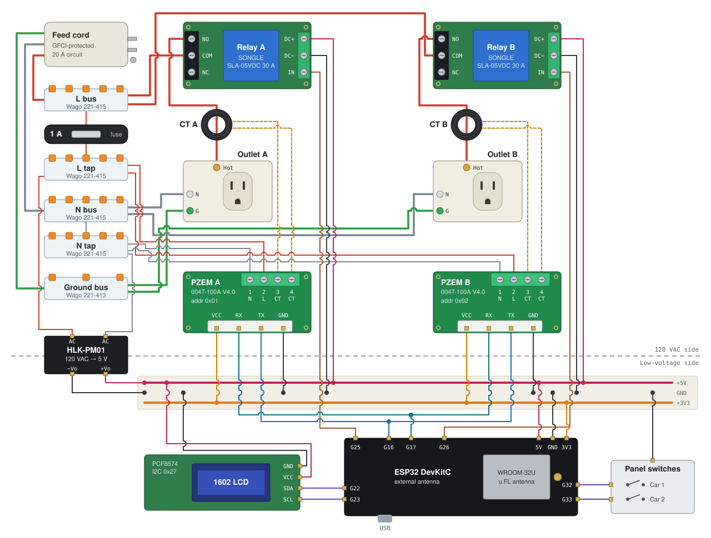
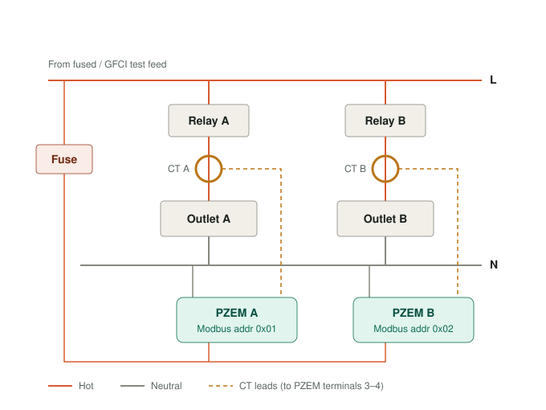

# Dual EV Charger Controller

An ESP32 controller that lets two Level 1 EV chargers share one 20 A garage circuit. Two relays switch two outlets, and a PZEM-004T energy meter on each outlet reports voltage, current, power, energy and power factor to Home Assistant over ESPHome. An interlock keeps both cars from drawing current at the same time, and a schedule hands charging from car 1 to car 2 overnight.

> [!WARNING]
> This project switches and measures 120 VAC mains. Build it only if you are qualified to work on mains wiring, keep the AC side in an enclosure, and feed the bench setup from a GFCI-protected circuit. Nothing here is a listed or certified product.

## Status

Bench build working, November 2026. Next step is moving it back into the enclosure.

- The first deployment could not hold a Wi-Fi connection from inside the enclosure. The controller now uses an ESP32 with an external u.FL antenna (WROOM-32U).
- Both PZEMs now answer on one shared UART, using a Schottky diode-OR on the TX lines and 5 V on the PZEM interface. See [Shared UART](#shared-uart-between-the-two-pzems).
- The LCD runs through a BSS138 level shifter, so the ESP32's I2C pins stay at 3.3 V.

## Features

- Two outlets with relay control, exposed to Home Assistant as `Car 1 Switch` and `Car 2 Switch`.
- Two-layer interlock. Turning one relay on turns the other off, and if both outlets draw more than 0.5 A anyway, relay 2 is cut.
- Per-car status for Home Assistant: `Idle`, `Waiting for Car`, `Charging` or `Done Charging`.
- No schedule or handoff logic on the device. Those run as Home Assistant automations, so they can change without reflashing. The controller keeps working as a pair of interlocked switches if Home Assistant is down.
- 16×2 LCD with per-outlet current, charging animation, a done indicator and an interlock warning.
- Two panel switches for manual control without Home Assistant.

## Bench wiring



An interactive version with the pre-power checklist and pin map is in [`docs/bench-wiring.html`](docs/bench-wiring.html). A PNG is at [`docs/bench-wiring.png`](docs/bench-wiring.png).

### AC side



- **Buses.** The GFCI feed lands on Wago 221 buses for L, N and ground. Feed, buses, relay contacts and outlets carry the charging load, so use 12 AWG to match the 20 A circuit.
- **Relays.** Each relay's COM takes L from the bus, and its NO contact feeds the outlet. NO keeps the outlets off when the ESP32 reboots or loses power.
- **CTs.** The CTs are solid-core toroids. Thread each outlet's hot through its CT before landing either end, and run only the hot through it, never L and N together. Keep the CT leads connected to the PZEM whenever load current can flow. The PZEM-004T doesn't report power direction, so CT orientation doesn't change the readings. Wire both channels the same way anyway (red to terminal 3).
- **PZEM voltage inputs.** Both PZEMs take L and N from a tap behind a 1 A fuse, upstream of the relays, so they keep measuring and answering on Modbus with the relays open.
- **PZEM terminal order.** The V4.0 boards have no rear silkscreen. Counting from the `VCC=3.3-5.0V` edge, terminal 1 is N, 2 is L, and 3–4 take the CT leads. This order is confirmed on the bench build. Check new boards with a meter before applying power: with power off, terminals 3–4 read low ohms through the CT burden resistor.
- **Power for the measurement side.** The PZEM's metering chip runs off the AC voltage terminals. With no mains on terminals 1–2 the module never answers on Modbus, including when you set its address.

### Low-voltage side

The HLK-PM01 supplies 5 V for the ESP32, the relay coils, the LCD and both PZEM interfaces. The PZEM TX lines reach the ESP32 through a diode-OR that keeps GPIO16 at 3.3 V, and the LCD connects through a BSS138 level shifter.

| ESP32 pin | Connects to | Notes |
| --- | --- | --- |
| `GPIO16` | Diode-OR junction (both PZEM TX) | UART2 RX, 10 kΩ pull-up to 3V3 |
| `GPIO17` | Both PZEM RX | UART2 TX, wired directly |
| `GPIO25` | Relay A `IN` | Car 1 |
| `GPIO26` | Relay B `IN` | Car 2 |
| `GPIO22` | Level shifter `LV1` → LCD `SDA` | PCF8574 backpack at 0x27 |
| `GPIO23` | Level shifter `LV2` → LCD `SCL` | |
| `GPIO32` | Panel switch, car 1 | Input pull-up, switch to GND |
| `GPIO33` | Panel switch, car 2 | Input pull-up, switch to GND |
| `5V` | +5 V rail | From HLK-PM01; feeds PZEM `VCC` |
| `3V3` | +3.3 V rail | Diode-OR pull-up, level shifter `LV` |

- **LCD level shifter.** The PCF8574 backpack pulls SDA and SCL up to its own 5 V supply, which is above the ESP32's 3.6 V absolute maximum. Running the backpack at 3.3 V instead leaves the display too faint, and a 3.3 V high is below the PCF8574's 0.7 × VCC (3.5 V) input threshold at 5 V. A BSS138 shifter keeps each side at its own level:

  | Shifter | Connects to |
  | --- | --- |
  | `LV` | 3V3 |
  | `HV` | +5 V |
  | `GND` | GND |
  | `LV1` / `LV2` | `GPIO22` / `GPIO23` |
  | `HV1` / `HV2` | Backpack `SDA` / `SCL` |

  Power down before moving any I2C wire. An unpowered PCF8574 holds the bus low, which crashes the ESP32's I2C recovery (`SCL is held LOW`).
- **Relay trigger.** Set the relay module's trigger jumper to H and confirm it switches from a 3.3 V GPIO.
- **5 V budget.** The HLK-PM01 is rated 600 mA. ESP32 Wi-Fi peaks (about 250 mA), two relay coils (about 90 mA each) and the LCD backlight total roughly 460 mA. The two PZEM interfaces add only a few mA.

### Shared UART between the two PZEMs

Both PZEMs sit on one Modbus RTU bus at different addresses, 0x01 and 0x02. Every module ships at 0x01, so set the addresses one module at a time, with AC live and only that module connected. See [`tools/pzem`](tools/pzem).

#### Setting PZEM B to address 0x02

PZEM A keeps the factory address, 0x01. Change PZEM B once, from a Mac or PC, before it goes on the shared bus. The address is stored in the module, so it survives power cycles and reflashing the ESP32.

You need a USB-to-TTL adapter (CP2102 or similar) and the scripts in [`tools/pzem`](tools/pzem).

1. **Disconnect PZEM A completely**, both its TTL header and its AC terminals. Every module answers at 0x01, so any other PZEM on the bus would also take the new address.
2. **Wire PZEM B's TTL header to the adapter:**

   | PZEM B | USB-to-TTL adapter |
   | --- | --- |
   | `VCC` | `5V` (the PZEM's RX opto is unreliable at 3.3 V) |
   | `GND` | `GND` |
   | `TX` | `RXD` |
   | `RX` | `TXD` |

3. **Apply AC to PZEM B's terminals 1 (N) and 2 (L)** from the fused, GFCI-protected bench feed. The metering chip runs off the AC side, so the module won't answer on Modbus without it. The CT doesn't need to be connected.
4. **Find the adapter's serial port** and set `port=` at the top of each script to match:

   ```sh
   ls /dev/cu.usbserial* /dev/cu.SLAB* /dev/cu.wch* 2>/dev/null
   ```

5. **Install the script dependencies** if you haven't already:

   ```sh
   python -m venv .venv && source .venv/bin/activate
   pip install -r requirements.txt
   ```

6. **Confirm the module answers at 0x01:**

   ```sh
   python tools/pzem/modbus-trble.py
   ```

   Expect `Address 1: responded with 1` and no response at address 2. If address 1 doesn't respond either, check TX/RX crossover and that AC is on terminals 1–2.

7. **Write the new address:**

   ```sh
   python tools/pzem/modbus-addr.py
   ```

   This writes `0x02` to the module's address register (holding register `0x0002`) on the module at 0x01. If the script reports an error after the write, run the next step before retrying, since the address may already have changed.

8. **Power-cycle the AC to PZEM B, then verify:**

   ```sh
   python tools/pzem/modbus-trble.py
   ```

   Expect no response at address 1 and `Address 2: responded with 2`.

9. **Label the module** "B / 0x02" so the two can't be swapped later.

Then reconnect PZEM A and put both on the shared bus. ESPHome's `pzemac` entries in `ev-charger.yaml` already expect address 1 for car 1 and address 2 for car 2.

#### Wiring the shared bus

The two PZEM TX lines can't be tied together directly. Each PZEM pulls its own TX pin up to VCC through a 4.7 kΩ resistor (R8, marked `472`, beside the header). When one module answers, its optocoupler has to pull the line low against the other module's pull-up as well, and it isn't strong enough to get close to ground. Each module works alone, and neither works with both connected.

A diode-OR isolates them:

| From | To | Notes |
| --- | --- | --- |
| PZEM A `TX` | D1 cathode (banded end) | Schottky: 1N5819, 1N5817, BAT43 or BAT54 |
| PZEM B `TX` | D2 cathode (banded end) | |
| D1 and D2 anodes, joined | `GPIO16` | Diode-OR junction |
| Diode-OR junction | 10 kΩ to 3V3 | Pull-up |
| `GPIO17` | Both PZEM `RX` | Direct; the two RX inputs draw about 4 mA together |
| Both PZEM `VCC` | +5 V rail | |

An idle module's diode is reverse-biased, so its 5 V pull-up is cut off from the junction. The module that's answering only has to pull down the single 10 kΩ, and GPIO16 never sees more than 3.3 V, so the PZEM TX path doesn't need the level shifter. Before connecting GPIO16, power up and measure the junction to GND: about 3.3 V is correct, and about 5 V means a diode is backwards.

Use Schottky diodes. A 1N4148 drops 0.6–0.7 V, which puts a low at roughly 0.9 V against the ESP32's 0.8 V maximum.

Two earlier attempts failed for reasons worth knowing:

- **PZEM `VCC` at 3.3 V.** The PZEM's RX input is an optocoupler LED in series with an indicator LED, which together drop about 3 V. At 3.3 V, the indicator glows on every request but the opto never switches reliably, so the modules hear the polls and never answer. The V4.0 silkscreen says 3.3–5.0 V, but power it from 5 V.
- **Diodes reversed.** With each anode toward the PZEM TX, an idle module pushes 5 V through its diode onto GPIO16, and a module pulling low can't pass through it.

## Bill of materials

| Qty | Part | Notes |
| --- | --- | --- |
| 1 | ESP32 DevKitC, WROOM-32U | External u.FL antenna |
| 2 | Peacefair PZEM-004T-100A V4.0 | With solid-core 100 A CT |
| 2 | 1-channel relay module, SONGLE SLA-05VDC-SL-C | 30 A contacts, 5 V coil |
| 1 | HLK-PM01 | 120 VAC to 5 V, 600 mA |
| 1 | 1602 LCD with PCF8574 I2C backpack | Address 0x27, 5 V |
| 1 | BSS138 bidirectional level shifter, 4-channel | Adafruit 757, SparkFun BOB-12009 or generic; 2 channels used |
| 2 | 15 A or 20 A receptacle | One per car |
| 2 | Toggle (maintained) panel switch | On while closed, off when opened |
| 1 | Inline fuse holder, 1 A fuse | For the PZEM and HLK-PM01 tap |
| 2 | Schottky diode, 1N5819 or similar | PZEM TX diode-OR |
| 1 | 10 kΩ resistor | Diode-OR pull-up to 3.3 V |
| 5 | Wago 221-415 | L bus, L tap, N bus, N tap |
| 1 | Wago 221-413 | Ground bus |

## Firmware

The ESPHome configuration is [`ev-charger.yaml`](ev-charger.yaml). It was built with ESPHome 2025.5.2.

1. Copy `secrets.example.yaml` to `secrets.yaml` and fill in your values. `secrets.yaml` is git-ignored.
2. Flash:

   ```sh
   python -m venv .venv && source .venv/bin/activate
   pip install -r requirements.txt
   esphome run ev-charger.yaml
   ```

## Home Assistant automations

Scheduling and handoff between cars are left to Home Assistant. The device exposes what automations need:

| Entity | Use |
| --- | --- |
| `switch.ev_charger_controller_car_1_switch`, `switch.ev_charger_controller_car_2_switch` | Turn an outlet on or off. Turning one on turns the other off. |
| `sensor.ev_charger_controller_car_1_status`, `sensor.ev_charger_controller_car_2_status` | `Idle`, `Waiting for Car`, `Charging` or `Done Charging` |
| `sensor.ev_charger_controller_car_1_current`, `sensor.ev_charger_controller_car_2_current` | Per-outlet current, plus voltage, power, energy and power factor |
| `binary_sensor.ev_charger_controller_simultaneous_charge_detected` | Interlock tripped |

Entity IDs depend on how the device was named when it was added, so check them in Home Assistant.

For a handoff, trigger on the active car's status changing to `Done Charging`, not on low current. An outlet only reaches `Done Charging` after its car has drawn current since the relay turned on, so an empty outlet stays at `Waiting for Car` and can't bounce the relays back and forth.

## PZEM tools

Python scripts in [`tools/pzem`](tools/pzem) talk to a PZEM through a USB-to-TTL adapter (CP2102), for setting and checking Modbus addresses off the ESP32. Edit the serial port at the top of each script first.

- `modbus-addr.py` changes the module at address 0x01 to 0x02. Run it with only the second module connected. See [Setting PZEM B to address 0x02](#setting-pzem-b-to-address-0x02).
- `modbus-trble.py` polls 0x01 and 0x02 and reports which answer.
- `modbus-trble1.py` reads the address register from the module at 0x02.

## Regenerating the diagram

The bench wiring diagram is generated from code, so wire changes stay in sync with the drawing:

```sh
python tools/diagram/build.py
```

PNG output needs `rsvg-convert` (`brew install librsvg`).

## License

[MIT](LICENSE)
